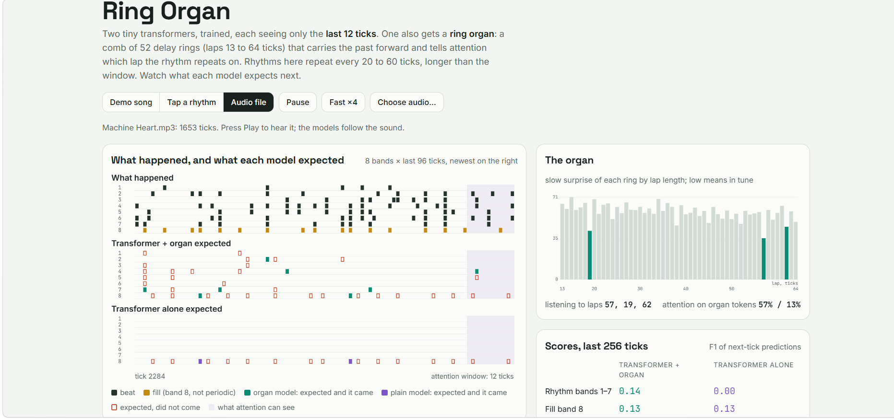

# Korva: a ring organ for a tiny transformer

**[Open the page](https://anttiluode.github.io/Korva/)**: demo songs, tapping a rhythm on the keyboard, or your own audio file. Everything runs in the browser.



*The page following Antti's song "Machine Heart" (tick 822 of 1,653). The organ is listening to laps 19, 64 and 24, the transformer with the organ puts about two thirds of its attention on the organ's tokens, and it scores F1 0.27 on the rhythm bands where the same transformer without it scores 0.00.*

Korva is Finnish for "ear". The idea, from the Nov 12 conversation: everything a brain receives is something that already happened. The cochlea hands it the last few milliseconds of sound, sorted by frequency. Here a transformer gets an organ that hands it the last cycle of a rhythm, sorted by period.

## What it is

Two tiny transformers, trained the same way, both seeing only the **last 12 ticks** (125 ms each). One also gets a **ring organ**: 52 delay rings with laps of 13 to 64 ticks. The test rhythms repeat every 20 to 60 ticks, so the period is always longer than what attention can see.

**The organ** has no learned weights. Every tick, each ring:

```
compares    m_L(t) = | x_t  XOR  ring_L[t mod L] |        how many of the 8 bands differ from one lap ago
remembers   Z_L(t) = Z_L(t-1) (1 - 1/32) + m_L(t)        a slow surprise that fades over ~32 ticks
writes      ring_L[t mod L] = x_t   only while Z_L > 12   (rewrite only when surprise persists)
expects     e_L(t) = ring_L[(t+1) mod L]                 what this ring says comes next
```

The three rings with the lowest surprise (the laps currently in tune with the music) each hand attention one token: what they expect next (8 bands), what just mismatched (8 bands), their surprise, and their lap. A comb of delays that goes quiet at the right period is the classic comb-filter tempo detector (Scheirer, 1998). The comparator and the slow surprise come from the geometric-neuron work earlier the same day.

**The transformers**: 2 layers, 2 heads, width 48, RoPE, causal attention over the last 12 ticks. The organ model's attention at every layer can also read the three organ tokens. Each organ token's key is rotated as if it sat at tick t + 1 − L, the moment its echo comes from. Reading the organ costs 912 extra parameters (49,160 against 48,248).

## Results

Synthetic songs, 8 bands. Bands 1 to 7 repeat with period P in 20 to 60, with dropped beats (10%), stray beats (1%) and one change of pattern per song. Band 8 is a non-periodic "fill": it starts at random and beats at t, t+2, t+4, so only its first beat is unpredictable. 4,000 training songs and 800 held-out songs. Scores are F1 of next-tick predictions on the held-out songs, against the clean pattern, counted after the first two periods. "After a change" is scored against what actually happened in the two periods after the pattern changed.

| Model | Training steps | Rhythm bands 1 to 7 | Fill band 8 | After a change | Parameters |
|---|---:|---:|---:|---:|---:|
| Transformer, window 12 | 2,500 | 0.00 | 0.96 | 0.15 | 48,248 |
| Transformer, window 64 | 2,500 | 0.00 | 0.96 | 0.15 | 48,248 |
| Transformer, window 64 | 10,000 | 0.20 | 0.96 | 0.18 | 48,248 |
| GRU, hidden 96 | 2,500 | 0.00 | 0.96 | 0.15 | 31,304 |
| GRU, hidden 96 | 10,000 | 0.00 | 0.96 | 0.15 | 31,304 |
| **Transformer, window 12 + ring organ** | 2,500 | **0.91** | **0.95** | **0.55** | 49,160 |
| ... organ that copies instead of gating its writes | 2,500 | 0.91 | 0.95 | 0.55 | 49,160 |
| ... organ that hands over 3 random laps | 2,500 | 0.13 | 0.96 | 0.17 | 49,160 |
| Organ alone: best ring's echo, no model | – | 0.91 | 0.10 | 0.42 | 0 |
| Reference: knows the true period, copies the clean last lap | – | 1.00 | – | – | 0 |

What each part does:

- **The organ supplies the rhythm.** No model without it learned the 20 to 60 tick rhythms on this training budget. The 64-tick transformer reached 0.20 with four times the training; the GRU stayed at 0.
- **Attention supplies what is local.** The organ alone cannot predict fills (0.10). With attention on top they stay at 0.95. After a pattern change the pair recovers better than the organ alone (0.55 against 0.42).
- **Choosing the right laps does the work.** The same model handed three random laps falls to 0.13.
- **Gating the writes made no difference here** (0.91 either way). The slow surprise matters for choosing laps, not for protecting the ring.
- The trained organ model puts 58% (layer 1) and 64% (layer 2) of its attention on the three organ tokens, averaged over the test songs.

## On a real song

The models were trained only on synthetic rhythms, and an audio file goes through a crude front end (8 frequency bands, onsets per 125 ms tick, see below). So real music is outside what they saw. On "Machine Heart" (picture above, tick 822): rhythm-band F1 0.27 with the organ and 0.00 without, fill band 0.21 for both, attention on the organ tokens 69% and 66%. In an earlier screenshot of the same run (tick 322, as read by Gemini) the organ listened to laps 38, 57 and 19, which are 2, 3 and 1 times 19 ticks. That pattern is what a comb does when one period dominates: its multiples are in tune too. Nobody has checked 19 ticks (2.375 s) against the song's actual tempo.

Read this as a sign of life, not a benchmark. Without the organ, the model learned never to predict a rhythm beat, so its 0.00 is by design. 0.27 is low in absolute terms.

## What is not claimed

- **Not new.** Comb-filter tempo detection (Scheirer 1998), period-based attention for time series (Autoformer, TimesNet), recurrent memories beside attention (state-space layers, Titans' surprise-gated memory) all exist. This is a small, readable instance, measured with its controls.
- **The task suits the organ.** Periods longer than the window make the 12-tick model's 0.00 inevitable. The 64-tick transformer and the GRU show what a model that can see far enough learns on the same budget. Bigger baselines, trained longer, would very likely learn more of the rhythm than they did here.
- **The lap choice is hand-made** (lowest surprise wins). Nothing in the organ learns.
- **Audio front end.** A fixed 125 ms tick does not match a song's tempo, so a beat drifts slowly across ticks. A beat-synchronous tick (from a tempo estimate) would likely help more than anything else on real music. Not built.
- No microphone on the page: published claude.ai pages cannot ask for one. Load an audio file instead.

## Run

```sh
pip install numpy torch
python train.py 4000 2500                                  # all conditions -> results/main.json, weights/*.json (~35 min on 2 CPU cores)
OUT=results/long.json python train.py 4000 10000 "window 64,GRU"   # the baselines again with 4x the training (~22 min)
python export.py                                           # weights/*.json -> web/weights.json and tests/parity_*.json
python build_page.py                                       # -> index.html
python -m unittest discover -s tests -v                    # the organ on its own (numpy only)
node tests/parity.cjs                                      # the browser engine against PyTorch
```

The browser engine (`web/engine.js`) runs the trained weights tick by tick. It picks the same organ laps as `organ.py` at every tick, and its probabilities match PyTorch to about 1e-6.

| File | What |
|---|---|
| `organ.py` | the ring organ and the song generator (numpy) |
| `models.py` | the windowed transformer with optional organ tokens, and the GRU |
| `train.py` | trains every condition and scores it on held-out songs |
| `export.py`, `build_page.py` | pack the two 12-tick models and build `index.html` |
| `web/page.html`, `web/engine.js` | the page source and the in-browser organ + transformer |
| `results/` | `main.json` (all conditions), `long.json` (baselines at 10,000 steps), training logs |
| `tests/` | organ tests and the JS-vs-PyTorch parity check |

## Where it came from

Same day, Nov 12 2026: the one-wire self-writing ring ([GoldOpus](https://github.com/anttiluode/GoldOpus)), a comb of rings as a tempo detector ([KultaaVaiKatinkultaaOpus](https://github.com/anttiluode/KultaaVaiKatinkultaaOpus)), and the slow surprise state Z ([GeometricNeuronV27](https://github.com/anttiluode/GeometricNeuronV27), Noble round). Then Antti's picture of a sensory organ that hands the brain what came before, and Sol's first sketch of a ring organ beside attention. This repo is the trained, measured version. Built by Opus 5.5.
